<div align="center">
  <h1>AndMX</h1>
  <p></p>
  <p><a href="https://github.com/shiaho777/andmx/actions/workflows/ci.yml"></a></p>
  <p><strong>An Android coding agent that works directly in your project.</strong></p>
  <p>Connect a model, ask it to read or edit code, and review proposed changes, terminal output, and file diffs in the same task.</p>
  <p><a href="#install-and-get-started">Install and get started</a> · <a href="#screenshots">Screenshots</a> · <a href="README.zh-CN.md">简体中文</a></p>
</div>

## Supported devices

AndMX runs on **Android 8.0 (API 26) and later**. The ARM64 APK targets API 34 and includes Android Linux Runtime and the Alpine base system. The first boot works offline. The terminal and Agent share the selected project at `/root/project`.

## Screenshots

The offline walkthrough below was captured from the signed preview candidate on an ARM64 Android emulator.

<p align="center">
  <a href="static/screenshot/quick-start.webp">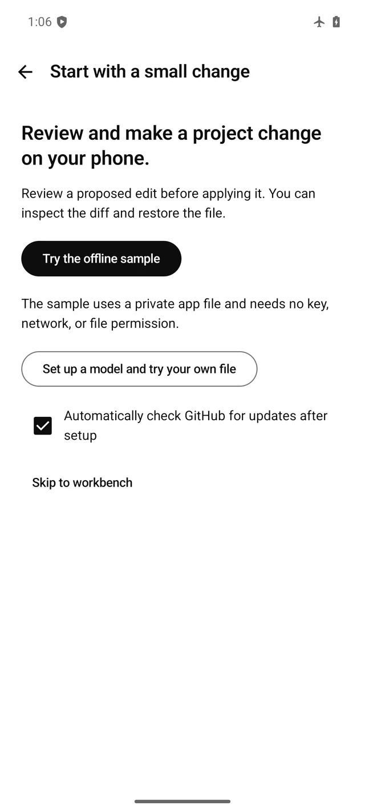</a>
  <a href="static/screenshot/sample-approval.webp">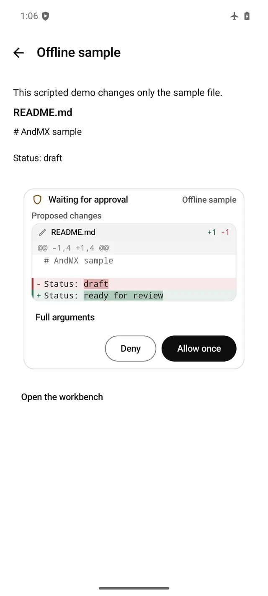</a>
  <a href="static/screenshot/sample-diff.webp">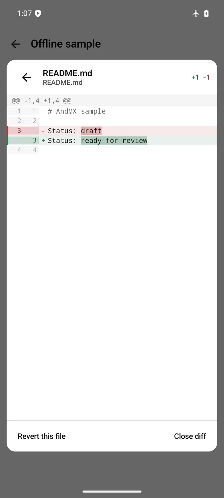</a>
</p>

The workbench screenshots below show the Android 15 build from `main` at [`509d1e2`](https://github.com/shiaho777/andmx/commit/509d1e206c30c6310f7c61dab87fdf45bb19c966). The task uses a demo model and a sample project. Select any image to open it at full size.

**One task, from request to review.** AndMX reads a validation note, asks before editing, runs a verification command after approval, and opens the resulting diff.

<p align="center">
  <a href="static/screenshot/conversation.webp">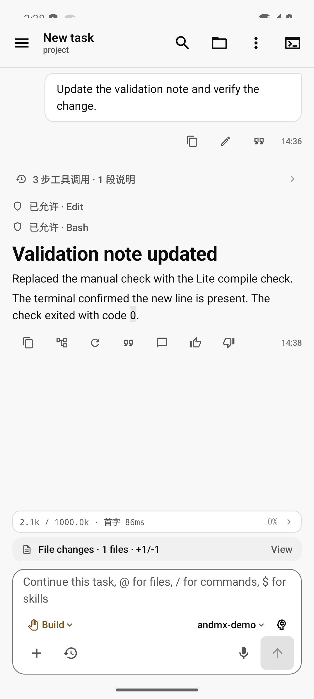</a>
  <a href="static/screenshot/edit-approval.webp">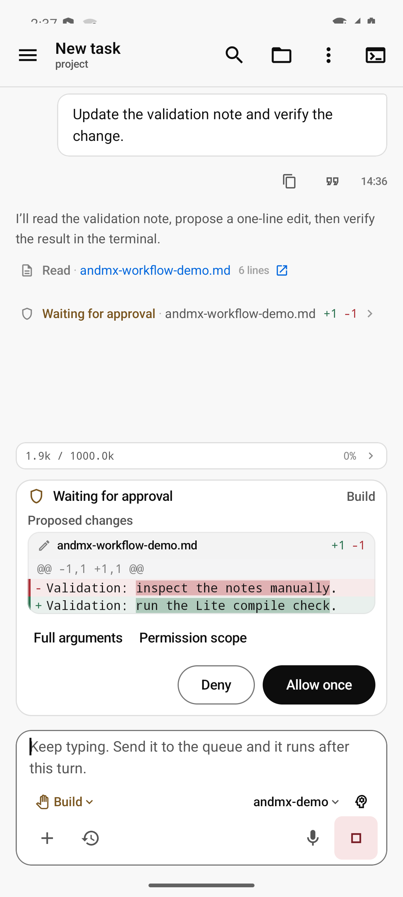</a>
  <a href="static/screenshot/file-diff.webp">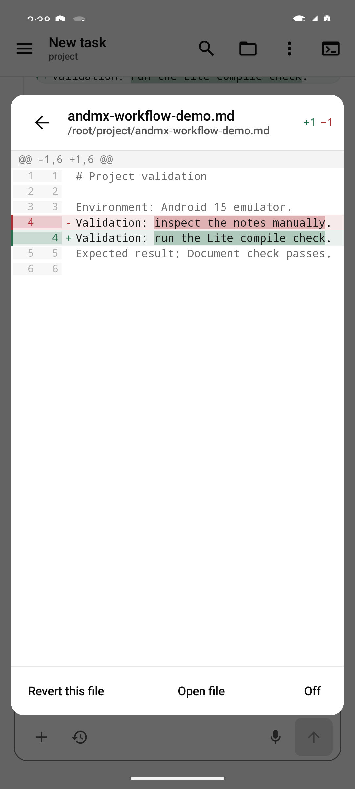</a>
</p>

<details>
<summary>New task, project and model pickers, sidebar and task search</summary>

<p align="center">
  <a href="static/screenshot/new-task.webp">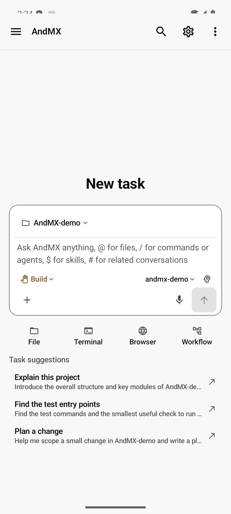</a>
  <a href="static/screenshot/project-picker.webp">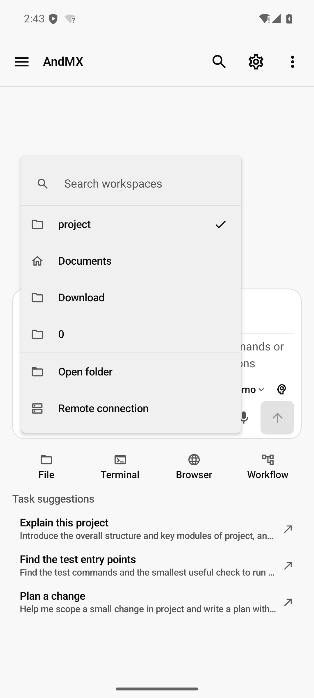</a>
  <a href="static/screenshot/model-menu.webp">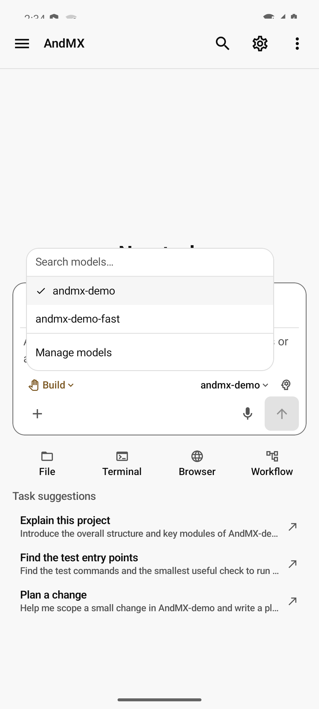</a>
  <a href="static/screenshot/sidebar.webp">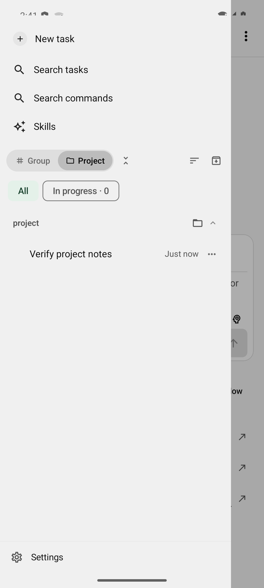</a>
  <a href="static/screenshot/task-search.webp">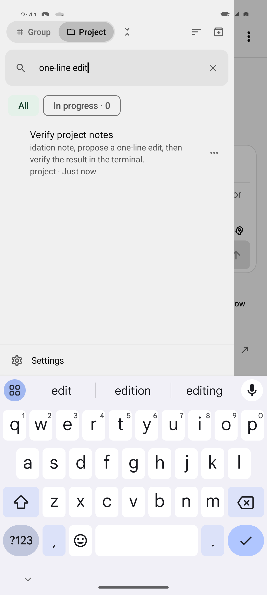</a>
  <a href="static/screenshot/message-match.webp">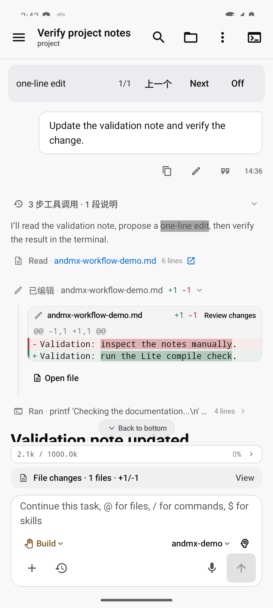</a>
</p>

</details>

<details>
<summary>Command approval, tool output, revert confirmation, terminal and files</summary>

<p align="center">
  <a href="static/screenshot/command-approval.webp">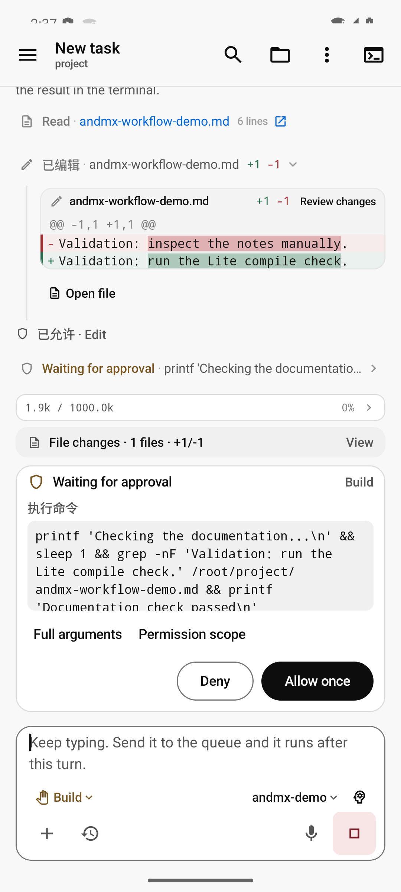</a>
  <a href="static/screenshot/tool-output.webp">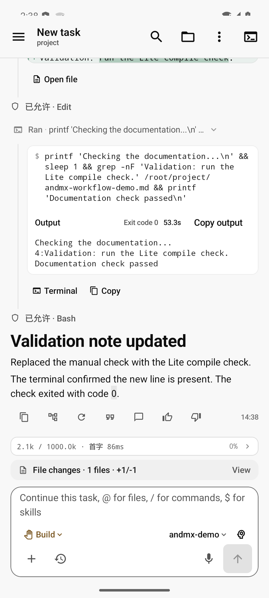</a>
  <a href="static/screenshot/revert-confirmation.webp">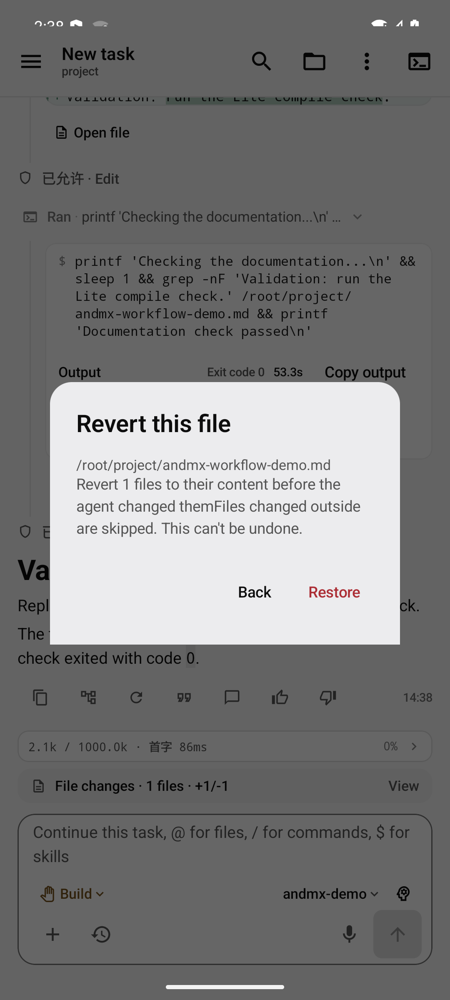</a>
  <a href="static/screenshot/terminal.webp">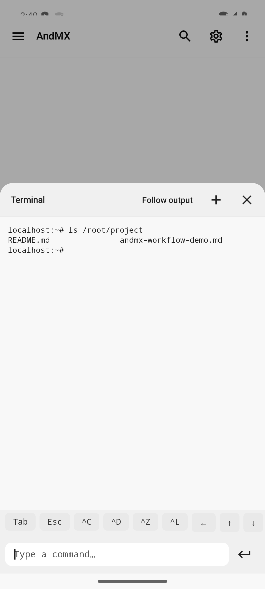</a>
  <a href="static/screenshot/file-browser.webp">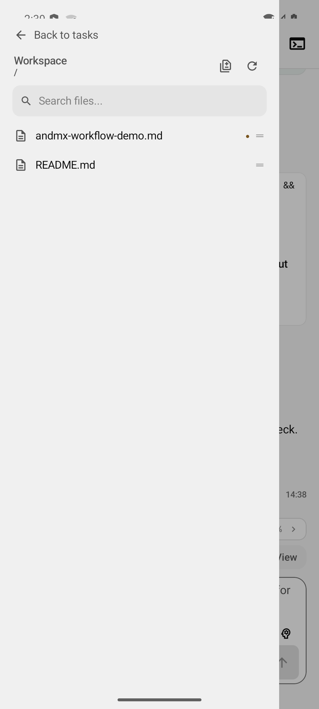</a>
</p>

</details>

<details>
<summary>Models, command search, browser, settings and dark appearance</summary>

<p align="center">
  <a href="static/screenshot/models.webp">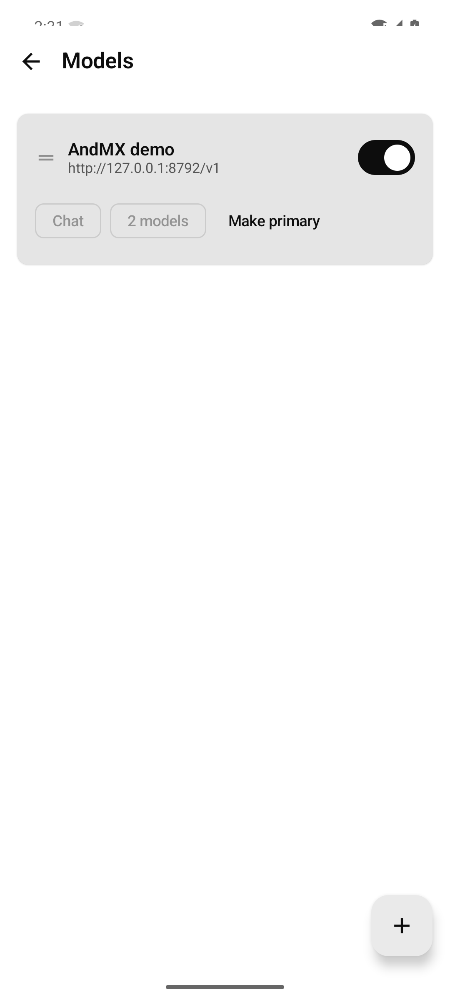</a>
  <a href="static/screenshot/settings.webp">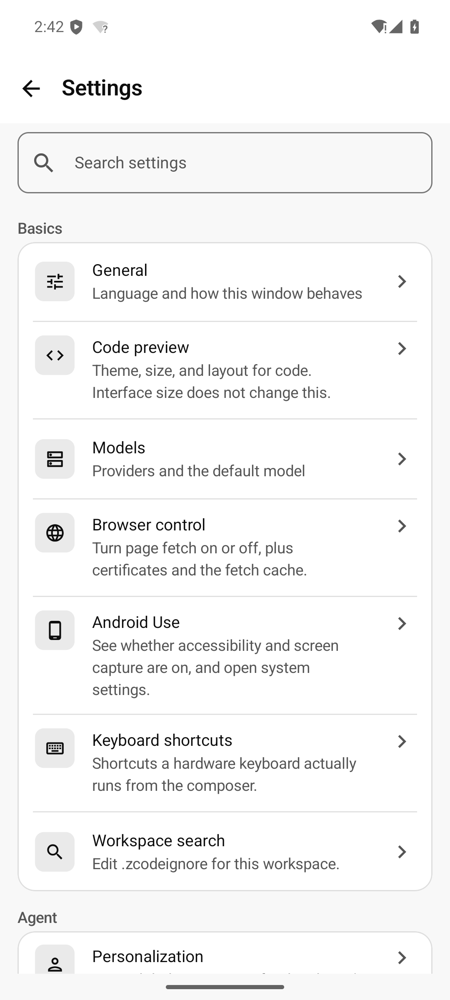</a>
  <a href="static/screenshot/command-search.webp">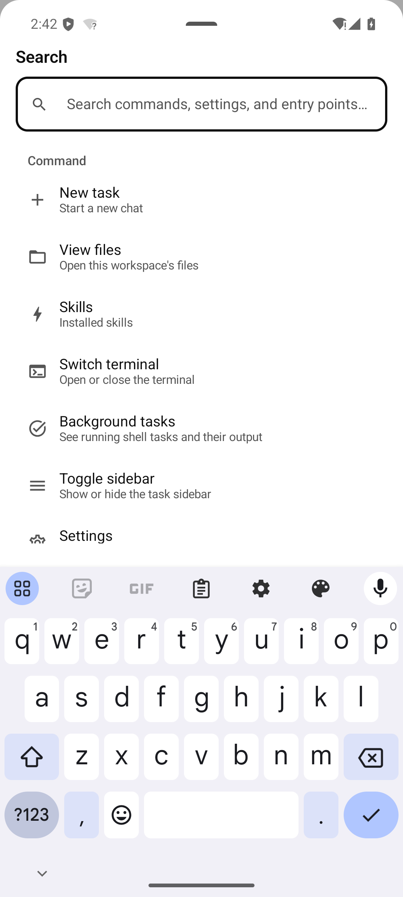</a>
  <a href="static/screenshot/browser.webp">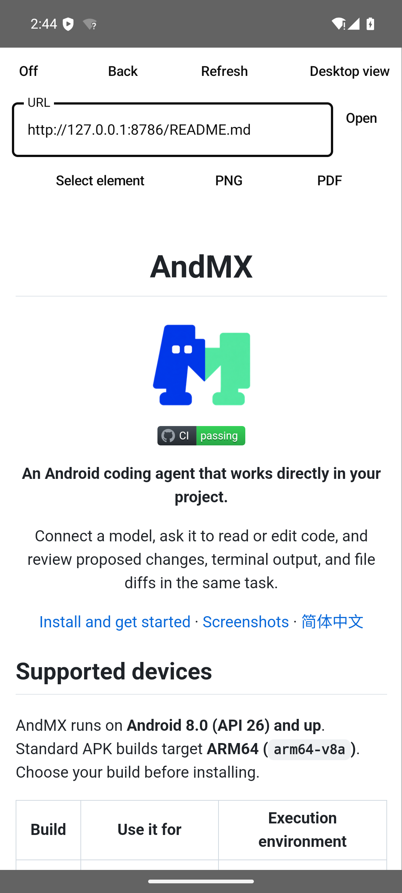</a>
  <a href="static/screenshot/dark.webp">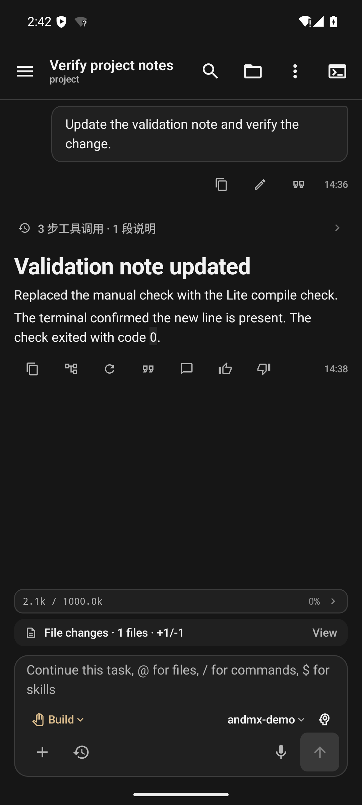</a>
</p>

</details>

## What you can do

| Task | How AndMX helps |
| --- | --- |
| **Work in a project** | Open a local directory, reference files with `@`, browse the workspace, and use file-editing and Git tools. A built-in Linux shell and PTY terminal are available on ARM64. |
| **Control tool execution** | In **Build** mode, reads run directly while file edits and commands ask for confirmation by default. Inspect the request, allow it once, or manage rules scoped to the task or project. |
| **Review results** | Expand tool cards to inspect inputs and output, including the exit code for shell runs. Open **File changes** for line-by-line diffs and review tracked changes before confirming a revert. |
| **Return to a task** | Search task titles and message text from the sidebar, jump to a match inside a folded process, and pick up where you were reading when switching tasks. |
| **Choose how to connect** | Use a provider or a reachable self-hosted endpoint via OpenAI Chat Completions, OpenAI Responses, or Anthropic Messages. Add tools through MCP, skills, and plugins. Android Use and experimental dynamic workflow tools are available in Settings. |

Track requested features and known issues in the [issue tracker](https://github.com/shiaho777/andmx/issues).

## Install and get started

On a fresh install, choose **Try the offline sample** to practice declining, approving, inspecting and restoring a local edit. Choose **Set up a model and try your own file** to import one UTF-8 text file of up to 32 KB. You confirm the selected model endpoint before sending its contents, review the proposed revision, and can save a separate copy from Android’s file picker. **Settings → Quick start** reopens both paths.

Permission status and data destinations are documented under **Settings → Privacy and permissions** and in the [privacy statement](PRIVACY.md). **Settings → About** provides project resources, GitHub feedback and a diagnostic preview you can copy.

Build from source with JDK 17, Android SDK 34, Build-Tools 34.0.0, NDK 27.0.12077973 and 28.2.13676358, CMake 3.22.1, Python 3.9+, Go 1.24+ and `mke2fs`. Set `ANDROID_HOME` to your SDK directory. The build verifies and packages pinned Linux inputs.

```bash
python3 -m venv .venv
.venv/bin/pip install -r linux-runtime/tools/requirements.txt
./gradlew :app:assembleDebug
```

The APK is at `app/build/outputs/apk/debug/app-debug.apk`. [Release runbook](docs/preview-release.md)

1. Open **Settings → Models → Add provider**. Choose the protocol and enter your provider’s base URL and any required API key. Fetch the model list or enter a model ID manually, then save.
2. In **New task**, select the model and choose a project folder. Android may prompt for all-files access when you open local projects.
3. Start with a small task, for example, “Read `README.md` and identify the local validation steps.” Keep **Build** mode selected if you want to approve edits and commands as they come up.
4. For a task that writes files, inspect the proposed change first. After execution, open **File changes** in the task to review the applied diff.

### Built-in Alpine Linux

Open **Terminal → Alpine Linux** and choose offline or network access. Alpine keeps installed packages on its virtual disk. Additional packages need access to their repositories. Close active Linux processes before switching the mounted project or network mode.

### What leaves the device

Workspace tools and the Alpine VM execute on the device. Model calls send prompts and the context needed for the task, which can include file excerpts and tool output, to your configured provider. Web and MCP tools can contact their own endpoints. Android Use needs screen-capture and accessibility permission for screen capture and interaction. [App permissions](app/src/main/AndroidManifest.xml)

## Contribute and get help

- Report bugs with the app version, Android version, build type, steps to reproduce, and expected and actual results. **Settings → About → Copy diagnostics** provides the version and device details. Remove credentials and private content from reports and screenshots. [Report an issue](https://github.com/shiaho777/andmx/issues/new)
- Contributions to Android UI, model adapters, tool behavior, tests, and documentation are welcome. The repository uses Issue-linked PRs into `main` with `CI / build` as its merge gate. [Contribution guide](CONTRIBUTING.md)

<details>
<summary>Source layout and local tests</summary>

| Location | Responsibility |
| --- | --- |
| [`ui2/`](app/src/main/java/com/andmx/ui2) | Native Jetpack Compose workbench, task history, settings and terminal UI |
| [`agent/`](app/src/main/java/com/andmx/agent), [`llm/`](app/src/main/java/com/andmx/llm) | Agent loop, permission policy, tool registry, model adapters and streaming |
| [`exec/`](app/src/main/java/com/andmx/exec), [`cpp/`](app/src/main/cpp) | Process execution, Alpine integration and PTY bridge |
| [`data/`](app/src/main/java/com/andmx/data), [`workspace/`](app/src/main/java/com/andmx/workspace), [`diff/`](app/src/main/java/com/andmx/diff) | Room persistence, project files, change tracking and diff rendering data |
| [`app/src/test/`](app/src/test), [`app/src/androidTest/`](app/src/androidTest) | Unit and instrumentation tests |

```bash
./gradlew :app:testDebugUnitTest
./gradlew :app:connectedDebugAndroidTest
```

For an x86_64 test emulator, add `-PtestAbi=x86_64` to the instrumentation command. [CI workflow](.github/workflows/ci.yml) · [Agent instructions](AGENTS.md)

</details>

## License and credits

The AndMX repository is publicly visible on GitHub and currently declares no project-wide license. Bundled components retain their own terms. See the [third-party inventory](THIRD_PARTY.md).
