<div align="center">
  <h1>AndMX</h1>
  <p></p>
  <p><a href="https://github.com/shiaho777/andmx/actions/workflows/ci.yml"></a></p>
  <p><strong>直接在 Android 上操作项目的编程 Agent。</strong></p>
  <p>接入模型，让它读代码、提出修改并执行验证。在同一个任务里查看权限请求、终端输出和文件差异。</p>
  <p><a href="#安装与快速开始">安装与快速开始</a> · <a href="#界面截图">界面截图</a> · <a href="README.md">English</a></p>
</div>

## 支持设备

AndMX 支持 **Android 8.0（API 26）及以上**。ARM64 APK 的目标 API 为 34，内置 Android Linux Runtime、Alpine 内核和基础系统，首次启动可离线完成。本地终端和 Agent 命令共享挂载到 `/root/project` 的项目。

## 界面截图

下列离线引导截图来自 ARM64 Android 模拟器上的 签名预览候选包。

<p align="center">
  <a href="static/screenshot/quick-start.webp">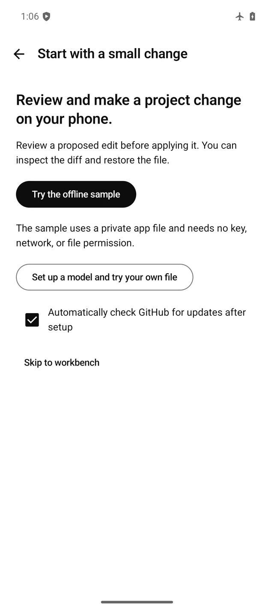</a>
  <a href="static/screenshot/sample-approval.webp">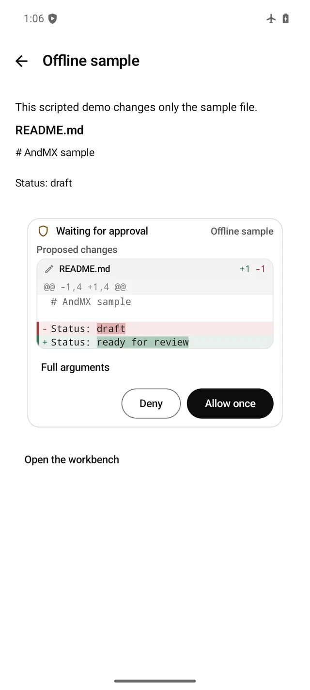</a>
  <a href="static/screenshot/sample-diff.webp">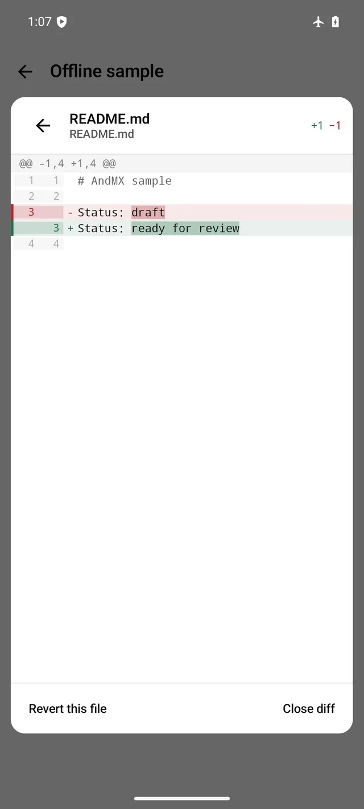</a>
</p>

下方的工作台截图来自 `main` 上的 [`509d1e2`](https://github.com/shiaho777/andmx/commit/509d1e206c30c6310f7c61dab87fdf45bb19c966)，运行于 Android 15 模拟器。示例任务使用演示模型和样例项目。点击图片可查看原尺寸。

**从发出任务到审阅结果。** AndMX 先读取验证说明，提交修改申请，获准后执行验证命令，最后打开实际改动的差异。

<p align="center">
  <a href="static/screenshot/conversation.webp">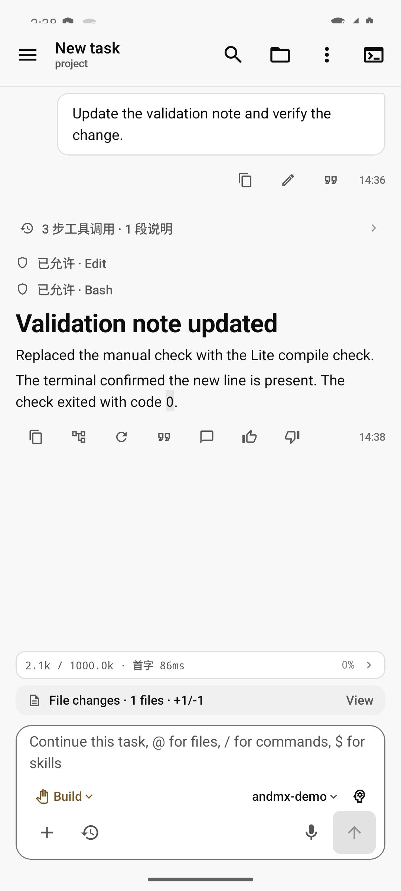</a>
  <a href="static/screenshot/edit-approval.webp">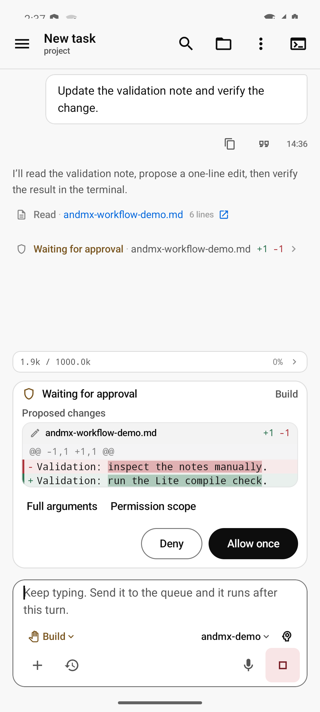</a>
  <a href="static/screenshot/file-diff.webp">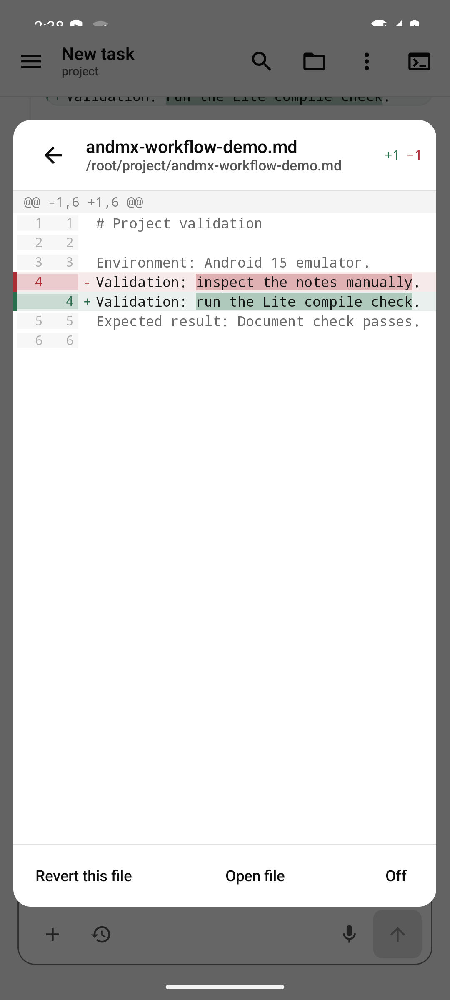</a>
</p>

<details>
<summary>新任务、项目和模型选择、侧栏与任务搜索</summary>

<p align="center">
  <a href="static/screenshot/new-task.webp">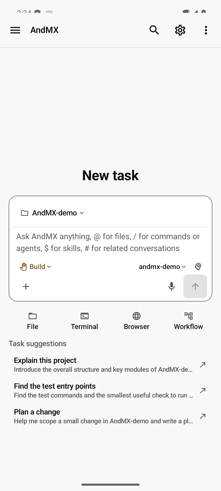</a>
  <a href="static/screenshot/project-picker.webp">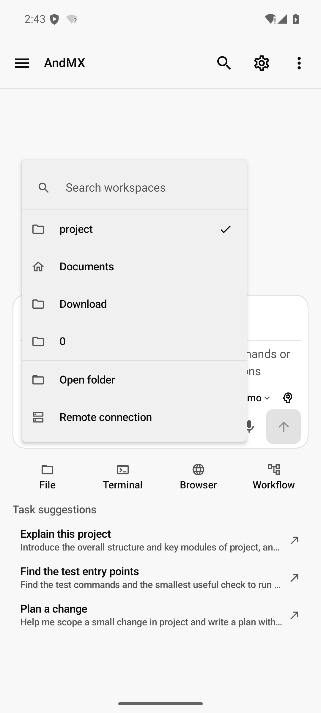</a>
  <a href="static/screenshot/model-menu.webp">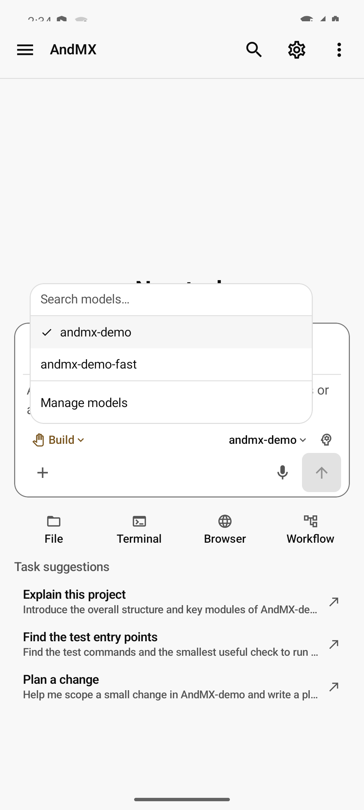</a>
  <a href="static/screenshot/sidebar.webp">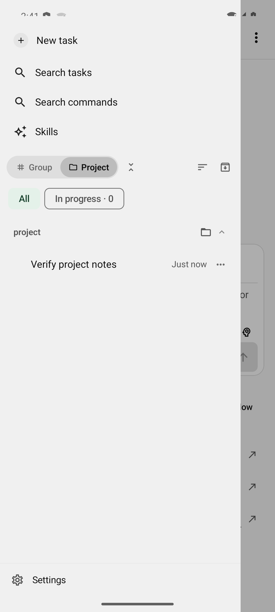</a>
  <a href="static/screenshot/task-search.webp">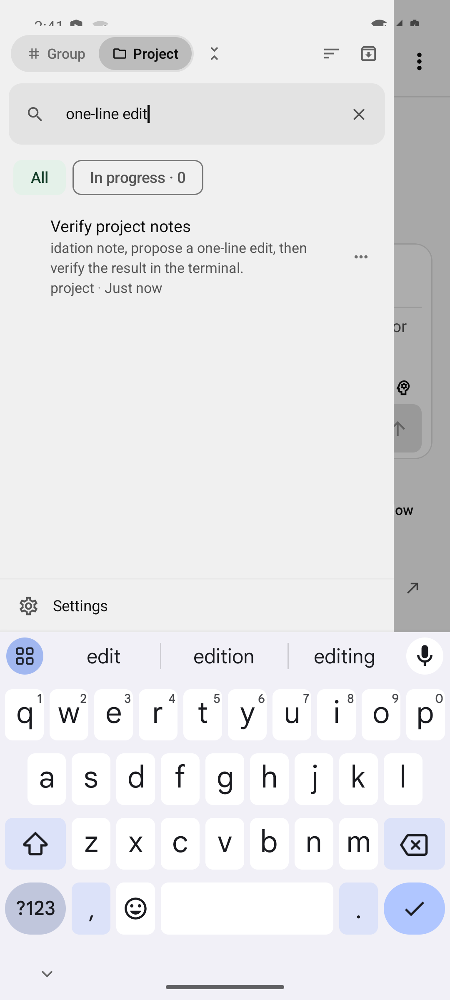</a>
  <a href="static/screenshot/message-match.webp">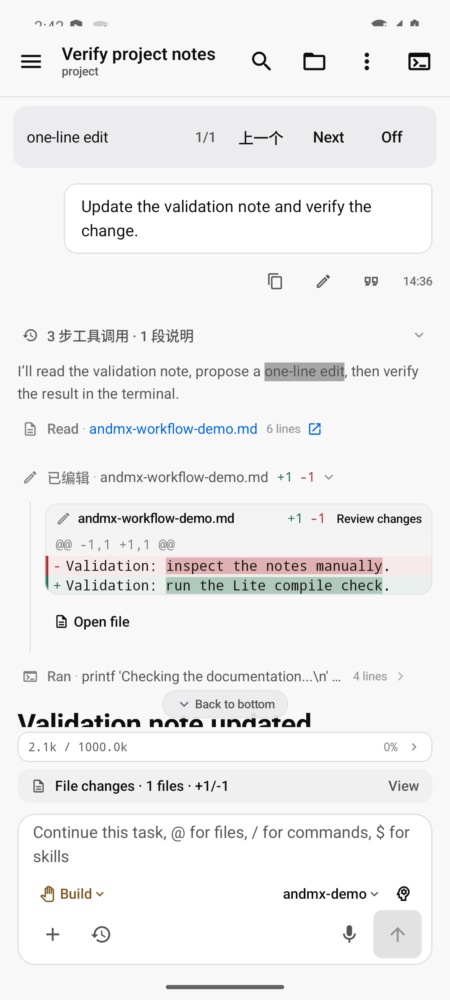</a>
</p>

</details>

<details>
<summary>命令确认、执行输出、还原确认、终端与文件浏览</summary>

<p align="center">
  <a href="static/screenshot/command-approval.webp">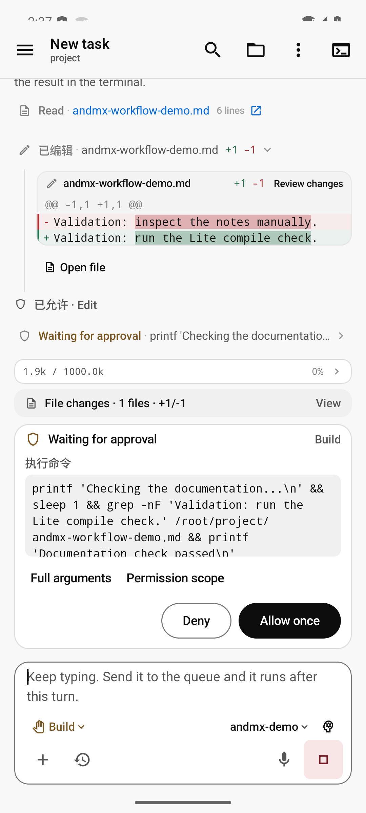</a>
  <a href="static/screenshot/tool-output.webp">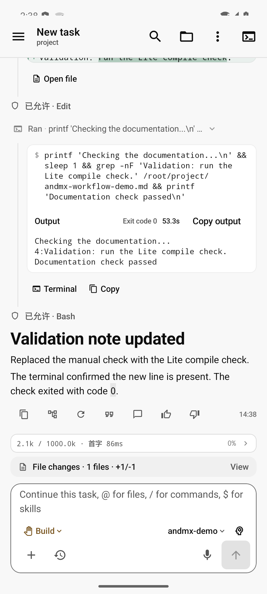</a>
  <a href="static/screenshot/revert-confirmation.webp">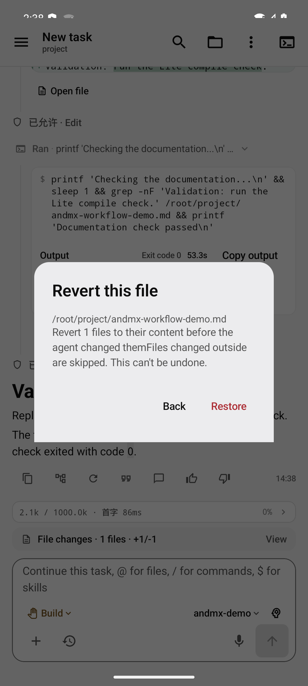</a>
  <a href="static/screenshot/terminal.webp">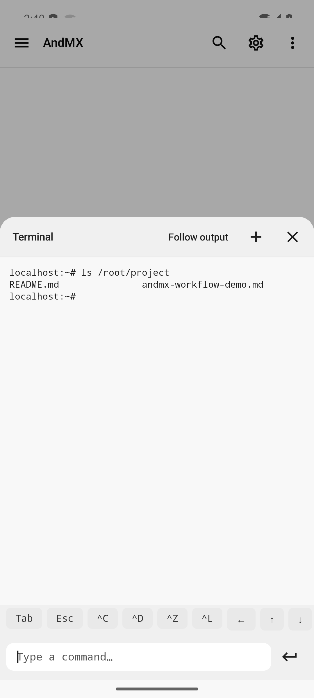</a>
  <a href="static/screenshot/file-browser.webp">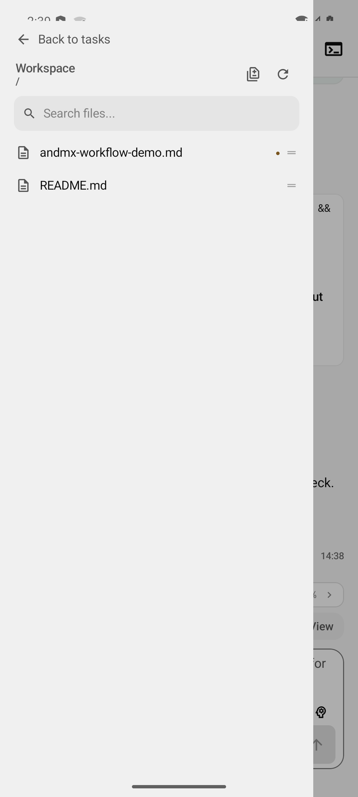</a>
</p>

</details>

<details>
<summary>模型管理、命令搜索、浏览器、设置与深色外观</summary>

<p align="center">
  <a href="static/screenshot/models.webp">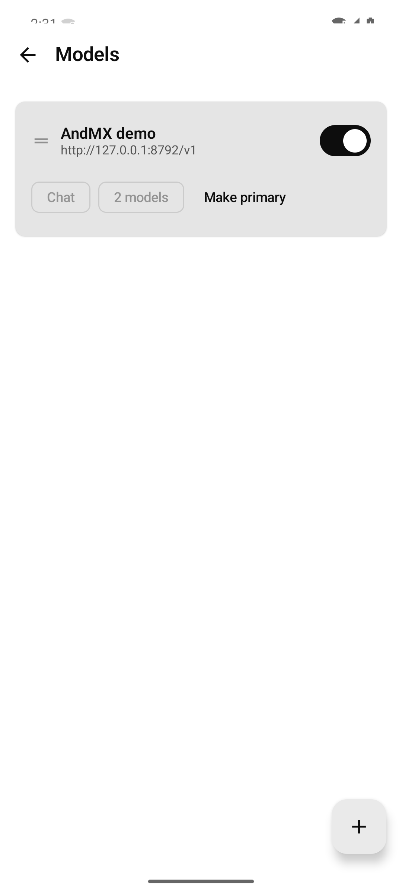</a>
  <a href="static/screenshot/settings.webp">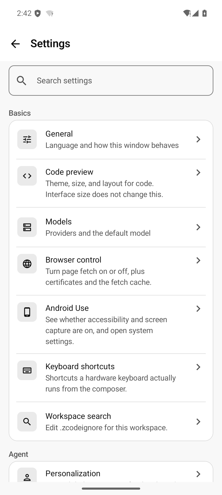</a>
  <a href="static/screenshot/command-search.webp">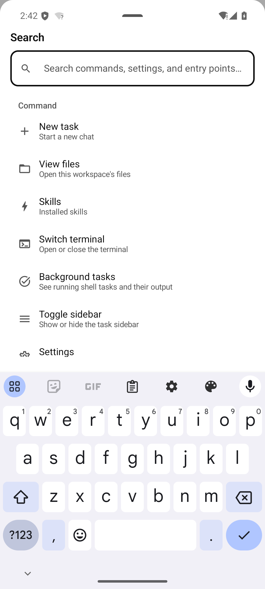</a>
  <a href="static/screenshot/browser.webp">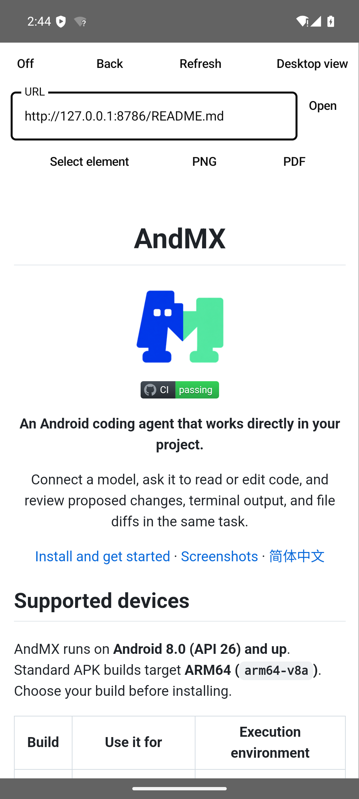</a>
  <a href="static/screenshot/dark.webp">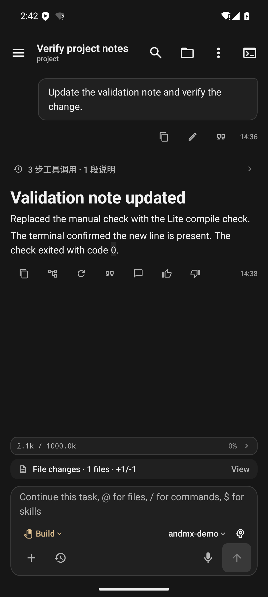</a>
</p>

</details>

## 能做什么

| 场景 | 在 AndMX 中怎么做 |
| --- | --- |
| **操作项目** | 选择本地目录，用 `@` 引用文件，浏览工作区，调用文件编辑和 Git 工具。ARM64 版本可使用内置 Linux Shell 和 PTY 交互终端。 |
| **控制工具执行** | 在默认的**构建**模式下，读取直接执行，工具修改文件或执行命令前请求确认。可以查看请求、仅允许一次，或管理任务与项目范围的规则。 |
| **审阅工作结果** | 展开工具卡片查看输入和输出，包括 Shell 命令的退出码。通过**文件改动**逐行审阅差异，并在确认后还原已跟踪的改动。 |
| **接着之前的任务做** | 从侧栏搜索任务标题和正文，跳转到折叠过程里的命中项。重新打开任务可接着上次位置阅读。 |
| **接入模型和工具** | 通过 OpenAI Chat Completions、OpenAI Responses 或 Anthropic Messages 接入供应商或可访问的自托管端点。通过 MCP、技能和插件扩展工具，也可以在设置中配置 Android Use 或开启实验性的动态工作流工具。 |

功能需求和已知问题见 [Issue 列表](https://github.com/shiaho777/andmx/issues)。

## 安装与快速开始

首次安装后可以选择 **体验离线样例**，实际完成拒绝、批准、查看差异和还原。选择 **配置模型并试用真实文件** 时，可以导入一个不超过 32 KB 的 UTF-8 文本文件。确认模型端点后发送内容，审阅通过后可以用 Android 文件选择器另存副本。**设置 → 快速入门** 可随时重新打开这两个入口。

**设置 → 隐私与权限** 集中显示授权状态和数据去向。**设置 → 关于** 提供项目文档、GitHub 反馈和可预览复制的诊断信息。[隐私声明](PRIVACY.md)

[发布流程](docs/preview-release.md) · [变更记录](CHANGELOG.md) · [第三方组件与授权](THIRD_PARTY.md)

从源码构建需要 JDK 17、Android SDK 34、Build-Tools 34.0.0、NDK 27.0.12077973 和 28.2.13676358、CMake 3.22.1、Python 3.9+、Go 1.24+ 和 `mke2fs`。将 `ANDROID_HOME` 设为 SDK 路径。构建时会校验并内置固定版本的 Linux 组件。

```bash
python3 -m venv .venv
.venv/bin/pip install -r linux-runtime/tools/requirements.txt
./gradlew :app:assembleDebug
```

APK 位于 `app/build/outputs/apk/debug/app-debug.apk`。[发布流程](docs/preview-release.md)

1. 在**设置 → 模型设置 → 添加供应商**中选择协议，填写 API 地址和所需密钥。拉取模型列表或手动填写模型 ID，然后保存。
2. 在**新建任务**中选模型和项目文件夹。打开本地项目时，Android 可能会要求授予所有文件访问权限。
3. 先试一个小任务，例如“读取 `README.md`，列出本地验证步骤”。保留**构建**模式，可以逐次确认文件编辑和命令执行。
4. 遇到写入请求时先检查拟议改动。执行后从任务里的**文件改动**打开实际差异。

### 内置 Alpine Linux

打开 **终端 → Alpine Linux**，选择离线或允许联网。安装到 Alpine 的软件保留在虚拟磁盘上。额外安装软件包需要访问软件源。切换挂载项目或网络模式前，先关闭还在运行的 Linux 进程。

### 哪些数据会离开设备

工作区工具和 Alpine 虚拟机在设备上运行。模型调用会把提示词及任务所需的上下文发给你配置的供应商，其中可能包含文件片段和工具输出。网页和 MCP 工具也可能访问各自的端点。Android Use 使用录屏与无障碍权限来读取画面和操作界面。[应用权限声明](app/src/main/AndroidManifest.xml)

## 贡献与反馈

- 报告问题时请附应用版本、Android 版本、构建类型、复现步骤、预期和实际结果。可在**设置 → 关于 → 复制诊断信息**获取版本和设备信息。提交截图或日志前请移除密钥和隐私内容。[提交 Issue](https://github.com/shiaho777/andmx/issues/new)
- 欢迎贡献 Android 界面、模型适配、工具行为、测试和文档。PR 需关联 Issue、以 `main` 为目标，并通过 `CI / build` 才能合并。[贡献指南](CONTRIBUTING.md)

<details>
<summary>源码结构与本地测试</summary>

| 位置 | 职责 |
| --- | --- |
| [`ui2/`](app/src/main/java/com/andmx/ui2) | Jetpack Compose 工作台、历史任务、设置和终端界面 |
| [`agent/`](app/src/main/java/com/andmx/agent)、[`llm/`](app/src/main/java/com/andmx/llm) | Agent 循环、权限策略、工具注册、模型协议和流式响应 |
| [`exec/`](app/src/main/java/com/andmx/exec)、[`cpp/`](app/src/main/cpp) | 进程执行、Alpine 接入和 PTY 桥接 |
| [`data/`](app/src/main/java/com/andmx/data)、[`workspace/`](app/src/main/java/com/andmx/workspace)、[`diff/`](app/src/main/java/com/andmx/diff) | Room 持久化、项目文件、改动跟踪和差异数据 |
| [`app/src/test/`](app/src/test)、[`app/src/androidTest/`](app/src/androidTest) | 单元测试与设备仪器测试 |

```bash
./gradlew :app:testDebugUnitTest
./gradlew :app:connectedDebugAndroidTest
```

在 x86_64 测试模拟器上运行仪器测试时，给第二条命令加 `-PtestAbi=x86_64`。[CI 工作流](.github/workflows/ci.yml) · [Agent 说明](AGENTS.md)

</details>

## 许可与致谢

AndMX 仓库在 GitHub 公开可见，目前尚未声明项目级许可证。随应用提供的组件适用各自的许可。[第三方组件与授权](THIRD_PARTY.md)
